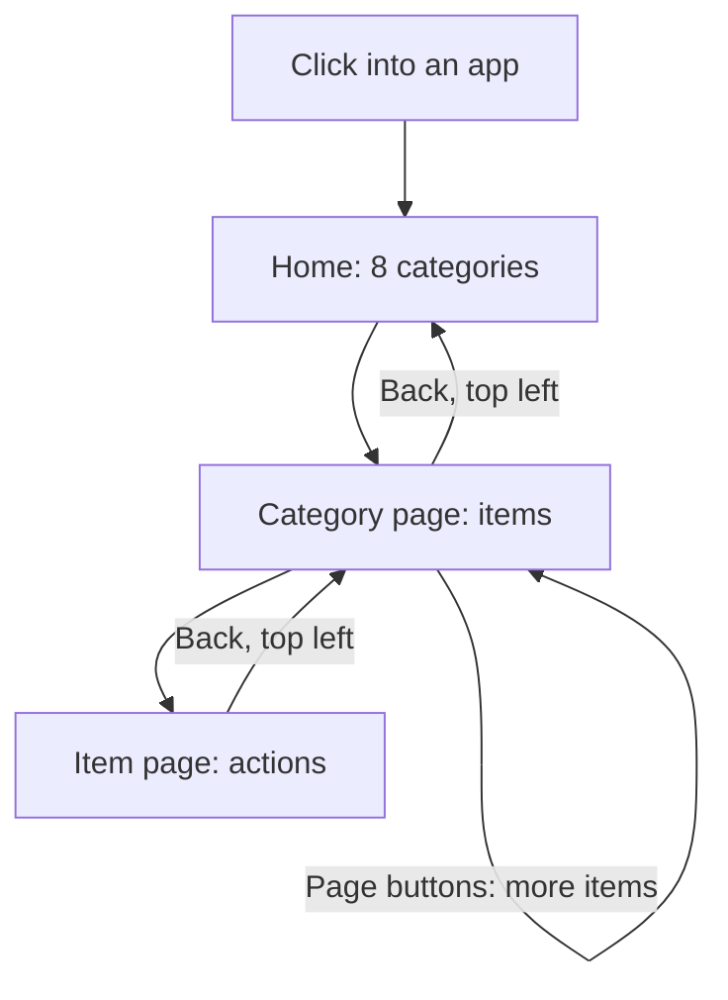
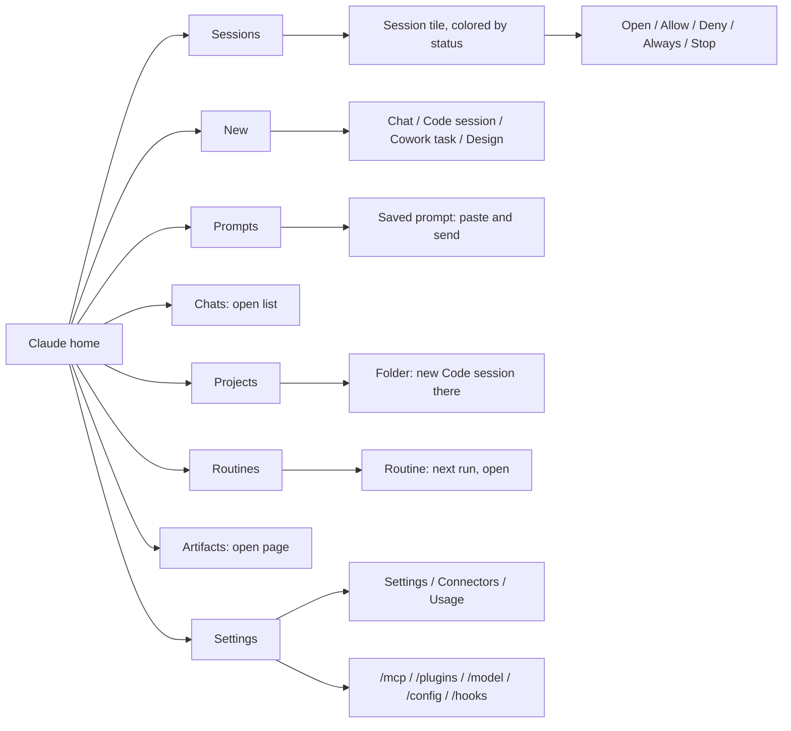
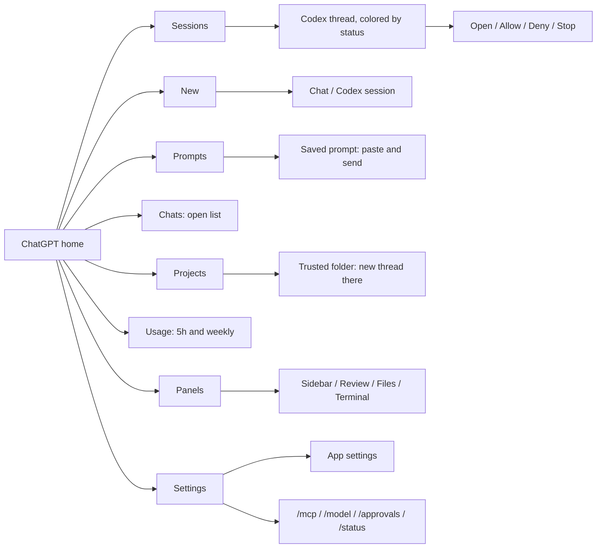
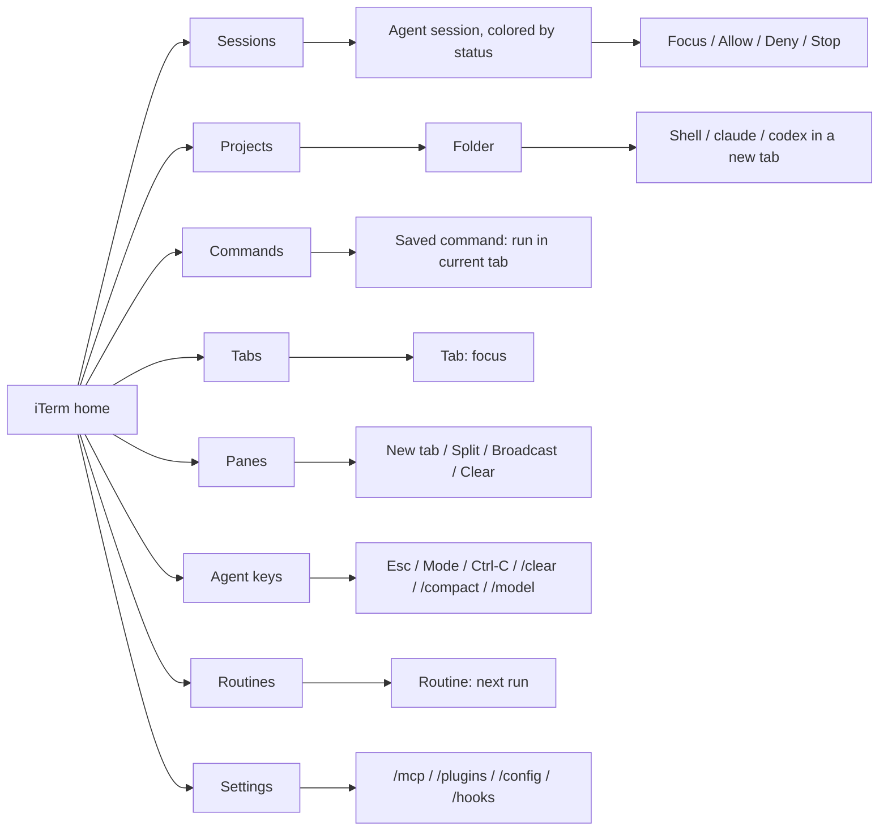

# Keypad workflow design

Status: approved design; the first build exists and awaits review on the keypad.

## Decisions

- No key is ever bound to a specific item such as "session slot 3"; every list is one high-level key that opens pages filled at run time.
- Lists longer than a page continue on the next page of the same folder.
- Sessions shows every agent everywhere, labeled by source (DESKTOP, CLI, CODEX).
- Status shows as a colored ring around the tile, as herdr does.
- On the home page, the bottom-left key is Next waiting; below the home page, the top-left key is always Back.

## Principles

- Clicking into an app shows a home page of categories, not a flat grid of commands.
- Every category opens a page of items, and an item can open a page of actions.
- The top-left key is always Back below the home page.
- The same category sits in the same key in every app, so muscle memory carries over.
- Parity goes below the home page too: Claude's layout is the guide, and an equivalent item in another app takes the same key (Claude's Chat and Code session are ChatGPT's Chat and Codex session).
- Tile colors mean the same thing everywhere.

## Status colors

| Color | Meaning |
| --- | --- |
| Blue | Working |
| Amber | Needs approval |
| Purple | Asking a question |
| Green | Done, waiting for your next prompt |
| Red | Failed |
| Gray | Idle or ended |

Status is a colored ring around the tile; amber and purple rings can pulse so a waiting session stands out from across the desk.

## Feasibility key

- List: the keypad can show the items, because a local file, hook, or tool provides them.
- Open: no source lists the items, so the key opens that view in the app or browser.
- Check: needs a short test before we commit to it.

## Inventory

### Claude Desktop

| Category | What the keypad shows | Press an item | Feasibility |
| --- | --- | --- | --- |
| Sessions | Every Claude Code session with its status color: Desktop, CLI, and Remote Control | Open it; its action page has Allow, Deny, Always, Stop, and Open | List (hooks and Desktop session files) |
| Scheduled | Local scheduled tasks and cloud routines with next run time | Open Claude Desktop | List (scheduled-tasks.json and the cloud helper) |
| Chats | One key | Opens the chat list | Open |
| Artifacts | One key | Opens the artifacts page | Open |
| Projects | Recent Code project folders, from Desktop session files | New Code session in that folder (`claude://code/new?folder=`) | List, and Check the folder deep link |
| Design | One key | Opens Claude Design | Check (Desktop has a `design` data folder; its contents are unknown) |
| Cowork | Cowork tasks | Open Cowork | Check (`local-agent-mode-sessions` exists; format unknown) |
| New | New chat, new Code session, new Cowork task | Starts it | List (deep links and menus) |
| Prompts | Saved prompts from prompts.json | Pastes and sends | List |
| Settings | Settings, Connectors, Usage, and Code commands `/mcp`, `/plugins`, `/model`, `/config`, `/hooks` | Opens the page, or types the command in the current Code session | Open for pages; Check for typing commands into a Desktop Code session |

### ChatGPT and Codex

| Category | What the keypad shows | Press an item | Feasibility |
| --- | --- | --- | --- |
| Sessions | Codex threads with status color, from hooks and the app server | Opens that thread (`codex://threads/<id>`) | List |
| Usage | 5-hour and weekly limits; press for the detail page | Refreshes | List (app server) |
| Chats | One key | Opens the chat list | Open |
| Projects | Trusted project folders from `~/.codex/config.toml` | Check: `codex://threads/new` takes no folder, so this needs Open Folder or the app server | List, and Check the action |
| New | New chat (File > New Chat), then new Codex session (`codex://threads/new`), in the same keys as Claude's Chat and Code session | Starts it | List |
| Prompts | Saved prompts from prompts.json | Pastes and sends | List |
| Panels | Sidebar, Review, Files, Terminal | Toggles it | List (menus) |
| Settings | App settings, Connections (`codex://settings/connections`), Plugins (`codex://plugins/`), and Codex commands `/mcp`, `/model`, `/approvals`, `/status` | Opens the page, or types the command | Open for pages; Check for typing into the app |
| Scheduled | Codex automations, which the app can create, run now, and delete | Run now or open | Check (the app has automations, but where their list lives is unknown) |

### iTerm

| Category | What the keypad shows | Press an item | Feasibility |
| --- | --- | --- | --- |
| Sessions | Every agent session running in iTerm with status color | Focuses its tab | List (hooks and iTerm session paths) |
| Tabs | Every iTerm tab by folder name | Focuses it | List (AppleScript) |
| Projects | Folders in `~/Projects` | New tab there, then a choice of shell, claude, or codex | List |
| Commands | Saved commands from iterm-commands.json | Runs it in the current tab | List |
| Panes | New tab, split right, split down, broadcast on and off, clear | Does it | List (AppleScript and menus) |
| Agent keys | Esc, mode (Shift+Tab), Ctrl-C, `/clear`, `/compact`, `/model` | Sends it to the current tab | List |
| Settings | `/mcp`, `/plugins`, `/config`, `/hooks` for Claude Code, and `/mcp`, `/approvals`, `/status` for Codex | Types it in the current tab | List |
| Routines | Same as Claude | Opens Claude Desktop | List |

### herdr

herdr runs inside a terminal app, so its keys live in the universal Birchpad Herdr plugin and open from key 5 of the iTerm home page.
The page and its keys are in `docs/herdr.md`.

| Category | What the keypad shows | Press an item | Feasibility |
| --- | --- | --- | --- |
| Agents | Every agent pane with its status color | Focus, Enter, Esc, Mode, Ctrl-C, Zoom | List (socket API `session.snapshot`) |
| New | Tab, workspace, splits, and each installed agent kind | Starts it in the focused pane's folder | List (detection manifests and the login shell PATH) |
| Workspaces | Every workspace with its agents' status | Focuses it, or opens its tabs | List |
| Worktrees | Git worktrees of the focused workspace | Opens it as a workspace | List (`worktree.list`) |
| Agent keys | Esc, Mode, Ctrl-C, `/clear`, `/compact`, `/model`, `/context`, `/usage` | Sends it to herdr's focused pane | List |
| Panes | Arrows, Zoom, splits | Does it | List |

## Proposed home page

All three apps share one grid, and iTerm's keys are the nearest equivalents of Claude's.
iTerm is mainly for running the claude and codex CLIs and dev commands.

| Key | Claude Desktop | ChatGPT and Codex | iTerm |
| --- | --- | --- | --- |
| 1 (top left) | Sessions | Sessions | Tabs (each pane with its agent's status) |
| 2 | New | New | New tab |
| 3 | Prompts | Prompts | Commands |
| 4 | Chats | Chats | Empty |
| 5 | Projects | Projects | Empty (Tabs covers projects) |
| 6 (middle right) | Scheduled | Scheduled | Agent keys |
| 7 (bottom left) | Next waiting | Next waiting | Next waiting |
| 8 (bottom middle) | Usage | Usage | Usage |
| 9 (bottom right) | Settings | Settings | Settings (iTerm's own) |

- Chats opens a page on Claude: Recent chats, Artifacts, and claude.ai Projects.
- Settings holds each app's panels: Sidebar, Terminal, Changes, and Side chat on Claude; Sidebar, Review, Files, and Terminal on ChatGPT; splits and broadcast on iTerm.
- iTerm's New tab opens a tab; it has no page, since starting claude or codex needs a folder choice the keypad cannot offer well.
- On iTerm, Tabs replaces Sessions: it lists every pane, with the agent running there found from its terminal.
- iTerm's Usage shows Claude and Codex limits together, since both CLIs run there.
- iTerm has no scheduled tasks, so its key 6 holds Agent keys.

### iTerm Agent keys

Keys are named by what they do and send the right command for the agent in the current tab.

| Key | Claude Code | Codex |
| --- | --- | --- |
| Esc | Esc | Esc |
| Mode | Shift+Tab | Shift+Tab |
| Ctrl-C | Ctrl-C | Ctrl-C |
| Clear | `/clear` | `/clear` |
| Compact | `/compact` | `/compact` |
| Model | `/model` | `/model` |
| Context | `/context` | `/status` |
| Usage | `/usage` | `/status` |

Agent Hub knows which agent runs in a tab by matching the tab's folder to a session it tracks; with no match, keys send the Claude Code command.

### iTerm Commands

Saved commands gain a `submit` flag.
A command with `"submit": false` is typed without pressing Return, so it can be finished by hand.

| Key | Command | Presses Return |
| --- | --- | --- |
| 1 | `git status` | Yes |
| 2 | `git pull` | Yes |
| 3 | `git checkout main` | Yes |
| 4 | `ddev init` | Yes |
| 5 | `ddev refresh` | Yes |
| 6 | `ddev drush ` | No |
| 7 | Back | |
| 8 | `ddev terminus ` | No |
| 9 | `ddev wp ` | No |

## Usage

The Usage key shows a summary with a ring colored by the highest limit: green under 70%, amber from 70%, red from 90%.
Pressing it opens a page with the detail.

| Detail | Claude | Codex |
| --- | --- | --- |
| 5-hour limit and reset time | Status line `rate_limits.five_hour`; Desktop `plan-usage-history.json` as fallback | App server `rateLimits.primary` |
| Weekly limit and reset time | Status line `rate_limits.seven_day`; Desktop file as fallback | App server `rateLimits.secondary` |
| Current session | Context used, cost, and lines changed from the status line | Context used, the number `/status` shows (Check: find where the app server or hooks expose it) |
| Plan and credits | None | Plan type and credit balance |
| History | Trend from the Desktop file's samples | Lifetime tokens, peak day, longest turn, streaks |

## Navigation

## Claude Desktop flow

## ChatGPT and Codex flow

## iTerm flow

## Checks before building

Answered from this Mac on 2026-09-27:

- `claude://code/new?folder=<path>` is the link Claude Desktop builds for "New Code session in <folder>", so Projects can use it.
- `codex://threads/<id>` opens a thread, and the hook session ID is the thread ID (checked against a live thread), so a Codex session tile can open its thread.
- `codex://threads/new` starts a Codex thread and takes a prompt (`q`) but no folder.
- Cowork tasks are JSON files under `local-agent-mode-sessions` with a title, last activity, an archived flag, and a scheduled task link, so Cowork can be listed.
- Claude Desktop's `design` folder is empty, so Design stays an open-only key.
- Codex keeps projects in `~/.codex/state_5.sqlite` (`projects` and `project_roots`), and thread titles in its `threads` table.
- Codex context use comes from the last `token_count` event in a thread's rollout log: last turn tokens over `model_context_window`, the same numbers `/status` shows.
- Codex automations exist in the app (create, run now, delete) but no local table or app server call lists them yet; Scheduled on ChatGPT stays a Check.

Still needs the keypad:

1. Whether a folder that returns `EncoderArea` from `GetNavigationArea` moves Back and paging onto the keypad's two page buttons.
2. That a blank filler key renders empty, so Back can sit in the top-left key without the keypad adding a second one.
3. Whether typing `/mcp` into a Claude Desktop Code session works the same as in the CLI.

## Open questions

- Whether the home grid order suits you; see the mockups in the chat that introduced this document.
